# Labs64.IO :: Tests

**A black-box regression suite for the Labs64.IO platform, run through the gateway edge.**
*Part of the [Labs64.IO Ecosystem](https://labs64.io): the cross-module safety net: every test exercises the gateway, never a backend port.*

[](https://github.com/Labs64/labs64.io-tests/actions/workflows/labs64io-regression-suite.yml)
[](LICENSE)
[](https://labs64.io/docs/development/contributing/)

<p align="center"></p>

[**Get started**](#get-started) · [Features](#features) · [Architecture](#architecture) · [AI agents](#using-tests-with-ai-agents) · [Ecosystem](#the-labs64io-ecosystem) · [Documentation](https://labs64.io/docs/development/contributing/) · [labs64.io](https://labs64.io)

> [!NOTE]
> The suite needs a running Labs64.IO stack reachable through its gateway edge. By default it expects the local k3d addresses (`http://gateway.localhost`); override them with environment variables for any other address.

## Why Tests?

A change in one module can break another, and the break shows up at the edge: a wrong scope, a missing route, a payment that never reaches the audit log. This suite checks the platform the way a client sees it:

1. **Edge only.** Every test goes through Traefik and the auth proxy, so authentication and authorization are always part of what is tested.
2. **Real tokens.** Tokens are minted with exact scopes from the mock identity provider or Keycloak.
3. **Tagged and filterable.** `smoke`, `regression`, `auth` and module tags let you run exactly the slice you need.

## Get started

Four ways in. Pick the one that matches what you have; each is complete on its own.

```
 1  install.sh             2  Kubernetes             3  Local                  4  Source
┌───────────────────────┐ ┌───────────────────────┐ ┌───────────────────────┐ ┌───────────────────────┐
│ Install a platform to │ │ Point the suite at    │ │ Create a venv,        │ │ Add a test or a       │
│ test: gateway, auth,  │ │ your cluster's        │ │ install the           │ │ module, keep the      │
│ AuditFlow and         │ │ gateway with          │ │ requirements, run     │ │ tags consistent,      │
│ Payment Gateway       │ │ GATEWAY_BASE_URL      │ │ the smoke tests       │ │ contribute back       │
├───────────────────────┤ ├───────────────────────┤ ├───────────────────────┤ ├───────────────────────┤
│ needs  a cluster,     │ │ needs  a stack,       │ │ needs  Python 3.14    │ │ needs  Python, Robot  │
│        kubectl, helm  │ │        Python 3.14    │ │                       │ │                       │
│ time   ~5 minutes     │ │ time   ~10 minutes    │ │ time   ~3 minutes     │ │ time   a few minutes  │
└───────────────────────┘ └───────────────────────┘ └───────────────────────┘ └───────────────────────┘
 get a stack to test       test your cluster         run the suite             work on the code
```

Not sure? Run **1** to get a stack, then **3** to run the smoke tests against it.

### 1. `install.sh`: the quick ecosystem start

The suite tests a running platform, so first get one. One script installs the gateway, AuditFlow and Payment Gateway on any Kubernetes cluster, then proves it with a real request. No cluster? A throwaway one on your laptop is enough:

```bash
k3d cluster create labs64io-demo -p "8000:80@loadbalancer" --k3s-arg "--disable=traefik@server:0"   # optional

curl -fsSL https://raw.githubusercontent.com/Labs64/labs64.io-helm-charts/master/install.sh -o install.sh
bash install.sh
```

Press Enter three times to take the defaults. You finish with a gateway you can `curl`, interactive API docs and a working token flow:

```text
  PASS  Obtained a demo access token from mock-oidc
  PASS  Published a demo audit event (HTTP 200) — first good request succeeded

 Labs64.IO is ready.
   Base URL:  http://localhost:8000
   API docs:  http://localhost:8000/swagger-ui/
```

The suite defaults to the local k3d addresses (`http://gateway.localhost`, `http://mock-oidc.localhost`); for an installer-created stack set `GATEWAY_BASE_URL` and `MOCK_OIDC_BASE_URL` to the addresses it printed. The same script later runs `status`, `stop`, `start` and `uninstall`. This is an evaluation install with a demo identity provider: keep it on a local or private cluster. Details: [Quickstart](https://labs64.io/docs/getting-started/quickstart/) · [`install.sh`](https://github.com/Labs64/labs64.io-helm-charts/blob/master/install.sh).

### 2. Kubernetes: on your own cluster

Point the suite at any cluster's gateway edge with environment variables:

```bash
export GATEWAY_BASE_URL=https://gateway.example.com
export KEYCLOAK_BASE_URL=https://keycloak.example.com   # when the stack uses Keycloak instead of mock OIDC
```

Tests that need pod logs are tagged `local-k8s-only` and are skipped or excluded elsewhere. See the [reference](docs/reference.md#targeting-a-different-environment) for every variable.

### 3. Local: on your machine

Needs Python 3.14:

```bash
git clone https://github.com/Labs64/labs64.io-tests.git && cd labs64.io-tests
python -m venv .venv && source .venv/bin/activate     # Windows: .venv\Scripts\activate
pip install -r requirements.txt

robot --include smoke --exclude not-ga tests/         # the fast gate
robot tests/auditflow/                                # one service
```

Robot writes `output.xml`, `log.html` and `report.html` to the current directory: open `log.html` first when a test fails.

### 4. Source: build and change it

Tests follow one convention: shared keywords in `resources/`, one folder per module under `tests/`, and tags for `smoke`, `regression`, `auth`, `flaky` and `not-ga`.

```
labs64.io-tests/
├── resources/              # common.resource (sessions, token minting) + per-module keywords
├── tests/
│   ├── auditflow/          # smoke.robot · authz.robot · …
│   ├── payment-gateway/    # smoke.robot · payment_providers.robot · authz.robot
│   └── common/             # cross-module probes
└── scripts/                # readiness gate, summaries, edge-image mirroring
```

[`AGENTS.md`](AGENTS.md) explains how to add a module and the narrow rules for `local-k8s-only` probes.

### Where next?

Everything below is in the [Tests documentation](https://labs64.io/docs/development/contributing/):

| I want to… | Read |
|---|---|
| See every command, tag and environment variable | [`docs/reference.md`](docs/reference.md) |
| Understand the platform under test | [Choose a deployment path](https://labs64.io/docs/getting-started/choose-a-deployment-path/) |
| Contribute a test | [Contributing guide](https://labs64.io/docs/development/contributing/) |
| Compare all the ways to run Labs64.IO | [Choose a deployment path](https://labs64.io/docs/getting-started/choose-a-deployment-path/) |

## Features

- **Gateway-edge only**: Traefik and the auth proxy are always in the path.
- **Exact-scope tokens**: minted from mock OIDC or Keycloak per test, so authorization is really exercised.
- **Auth matrix**: a generated suite checks every route against the scopes it should and should not accept.
- **Module coverage**: AuditFlow, Payment Gateway and the cross-module audit delivery probe.
- **Tags**: `smoke`, `regression`, `auth`, `flaky`, `not-ga`, `local-k8s-only`.
- **CI-ready**: a nightly workflow and a readiness gate that fails fast on unrecoverable pods.

## Architecture

```
  ┌────────────────────────────────────────────┐
  │ Robot Framework suite   tests/ + resources/│
  └──────────────┬──────────────┬──────────────┘
                 │ mint token   │ HTTP
        ┌────────▼─────┐   ┌────▼───────────────────────────────┐
        │ mock OIDC or │   │ Gateway edge: Traefik + auth proxy │
        │ Keycloak     │   └────┬───────────────────────┬───────┘
        └──────────────┘        │                       │
                       ┌────────▼───────┐      ┌────────▼────────┐
                       │ AuditFlow      │      │ Payment Gateway │
                       └────────────────┘      └─────────────────┘
  results: output.xml · log.html · report.html · CI job summary
```

## Using Tests with AI agents

Tests is the objective check an agent should run before and after touching any module.

- **Pick the narrowest slice.** `robot --include smoke --exclude not-ga tests/` is the fast gate; `robot tests/<module>/` runs one service.
- **Read `log.html` first.** It carries the full request and response for every failing keyword.
- **Respect the edge rule.** New tests go through the gateway; the only exception is an explicitly tagged `local-k8s-only` probe.
- **Working on the code with an agent?** [`AGENTS.md`](AGENTS.md) describes the conventions, tags and how to add a module.

## The Labs64.IO Ecosystem

Tests is one module of the [Labs64.IO Ecosystem](https://labs64.io); [every module is documented here](https://labs64.io/docs/).

| Module | What it does | Link |
|---|---|---|
| **AuditFlow** | Audit-event routing pipeline | [labs64.io-auditflow](https://github.com/Labs64/labs64.io-auditflow) |
| **API Gateway** | Authenticating, policy-enforcing edge for all modules | [labs64.io-authproxy](https://github.com/Labs64/labs64.io-authproxy) |
| **Payment Gateway** | One API over multiple payment providers | [labs64.io-payment-gateway](https://github.com/Labs64/labs64.io-payment-gateway) |
| **Checkout** | Embeddable, brandable checkout | [labs64.io-checkout](https://github.com/Labs64/labs64.io-checkout) |
| **Customer Portal** | Customer self-service UI | [labs64.io-customer-portal](https://github.com/Labs64/labs64.io-customer-portal) |
| **Commons** | Shared Java and Python libraries | [labs64.io-commons](https://github.com/Labs64/labs64.io-commons) |
| **Helm Charts** | Kubernetes deployment for every module | [labs64.io-helm-charts](https://github.com/Labs64/labs64.io-helm-charts) |
| **Workspace** | Dev container and multi-repo tooling | [labs64.io-workspace](https://github.com/Labs64/labs64.io-workspace) |
| **Tests** | Cross-module regression suite | [labs64.io-tests](https://github.com/Labs64/labs64.io-tests) |
| **Docs** | Published documentation | [labs64.io-docs](https://github.com/Labs64/labs64.io-docs) |
| **NetLicensing** | Licensing-as-a-Service: license and entitlement management | [netlicensing.io](https://netlicensing.io) |
| **GuideChimp** | Interactive guided product tours | [labs64.com/guidechimp](https://www.labs64.com/guidechimp/) |

## Contributing

Contributions of all sizes are welcome. Fork, branch, run the checks described in [`AGENTS.md`](AGENTS.md), and open a pull request. If you are unsure whether something fits, open an issue first.

## License

The core of the *Labs64.IO Ecosystem* is entirely open source and free forever. Community modules are licensed under [Apache License 2.0](LICENSE).

---

<p align="center">
  <a href="https://labs64.io"></a><br>
  <sub>Made by the <a href="https://labs64.io">Labs64</a> team and community.</sub>
</p>
